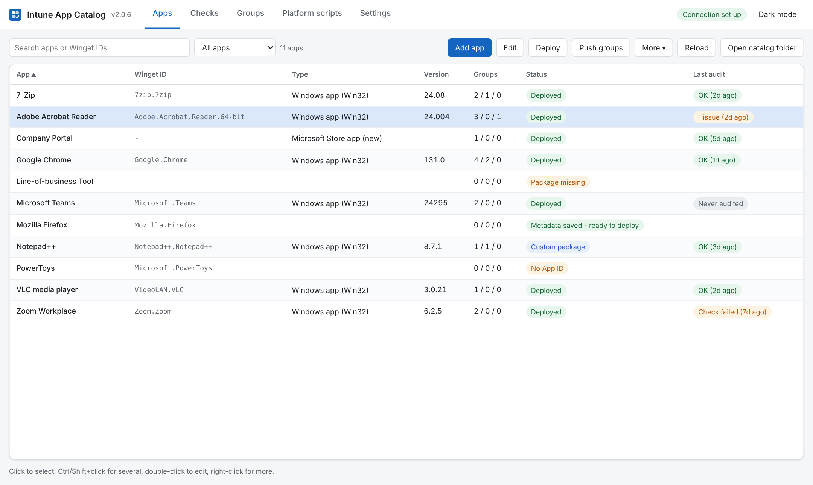
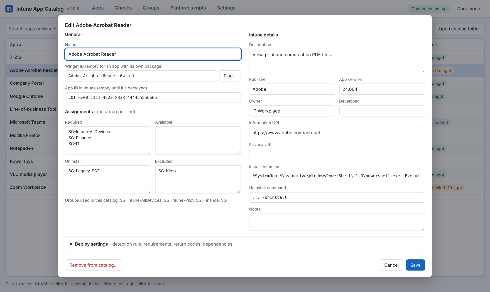
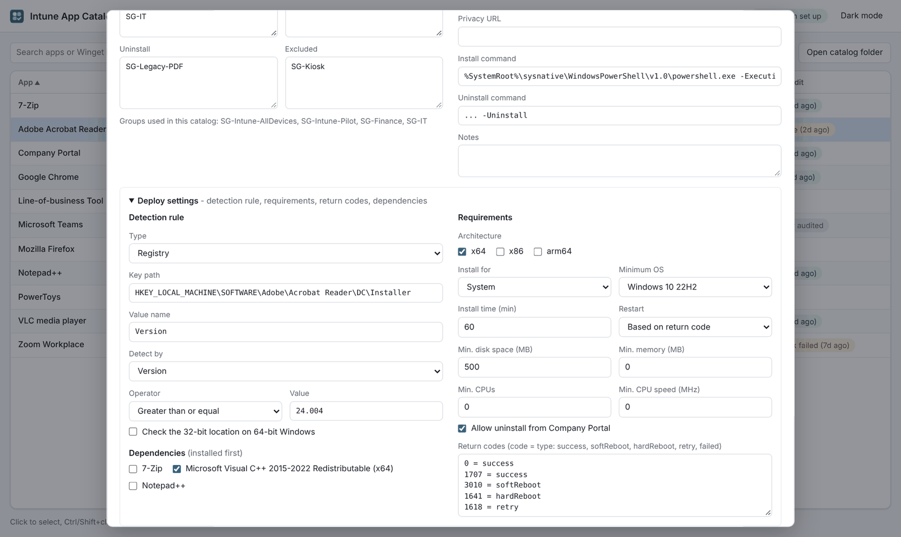
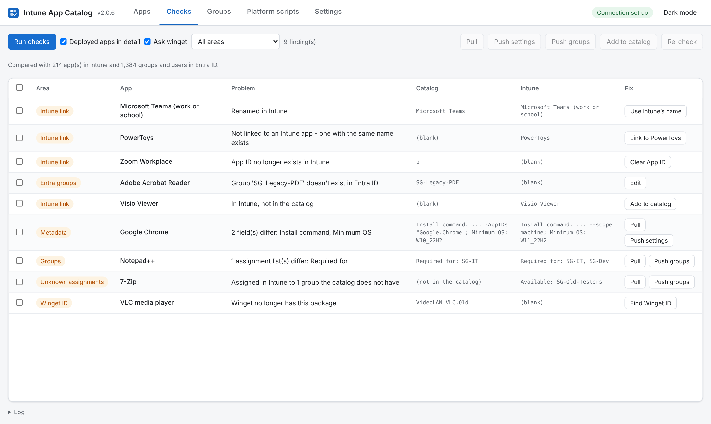
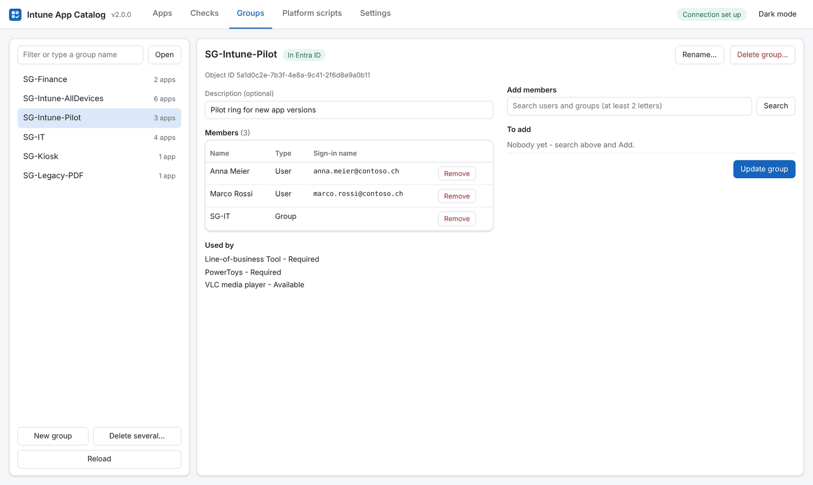
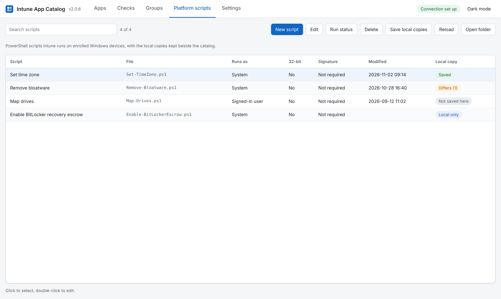
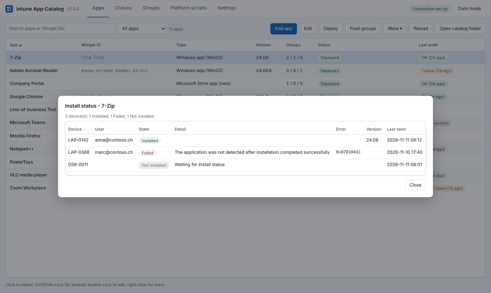

# Intune App Catalog & Deployment

[](https://github.com/monsama/intune-app-catalog/actions/workflows/tests.yml)
[](LICENSE)
[](#requirements)

A PowerShell tool for managing Intune Win32 apps. Each app is a JSON file
in a folder you choose (it can live in git). From there you package,
deploy and assign the apps, and check that Intune still matches.

It runs on your own machine: a small local server on `127.0.0.1` and an
Edge or Chrome app window. Nothing is hosted anywhere, and only the window
it opens can talk to it.



## What it does

**Catalog**
- One file per app: name, Winget ID, App ID, groups, and the full Intune
  settings (install/uninstall commands, detection rule, requirements,
  return codes, dependencies).
- Winget apps get their install command, uninstall command and detection
  rule generated, so a new app is usually just a name and a Winget ID -
  **Find...** looks the ID up on winget.
- A backup before every change, and a check that two apps can never
  overwrite each other's file.

**Intune**
- Deploy one app or several, in dependency order. Push settings without
  uploading a package.
- Assign groups per app - Required, Available, Uninstall, plus **Excluded**,
  with a preview of exactly what will change before anything is pushed.
- Batch edit settings, and add, remove or replace groups, on several apps
  at once - with a preview of every change before it's written, and
  **Undo** for the last bulk change.
- **Export to CSV / Import from CSV** (Catalog menu): edit many apps in
  Excel; the import shows every change first and is checked like the editor.
- Saved views in the Apps list, and `group:name` in the search box.
- **Set up this tenant** (Catalog menu, or the banner after copying a
  catalog): stale App IDs, missing groups, apps to deploy and groups to
  push, step by step.
- **Install status of every app** at once, worst first.
- App **icons**, sent to Intune and the Company Portal; **supersedence** in
  the editor; **newer versions on winget** flagged in the list.
- **Earlier versions** show what each save changed.
- **Managed updates** for Winget apps: each app installs a fixed version;
  a new one is released to a pilot group first (a new Intune app that
  supersedes the current one), then promoted to everyone - or withdrawn.
  Intune reports every device's state per version. Own packages too: the
  version comes from the installer in the app's folder. The **Updates**
  tab shows them all: versions, pilot verdicts, devices on the current
  version, a CSV export. See [docs/managed-updates.md](docs/managed-updates.md).
- **Nightly run** (`IntuneDeployment.ps1 -RunUpdates`, scheduled from
  Settings): promotes pilot releases by a rule (days, failure %, installs),
  releases new winget versions to pilot, and writes a report.
- **Roll back** to the previous version, and **delete old versions** from
  Intune (one is always kept for rollback) - by hand or in the nightly run.
- Pull settings and groups back from Intune, field by field.
- **Checks**: every way the catalog and Intune can disagree - apps renamed
  in Intune, App IDs that no longer exist, apps only in Intune, settings,
  groups, dependencies, assignments the catalog doesn't know, groups that
  don't exist in Entra ID, Winget IDs winget no longer knows - each with its
  fix.
- Install status per app: which devices and users have it, and which
  failed with what error.
- Platform scripts: list, add, change, delete the PowerShell scripts Intune
  runs on enrolled devices, keep local copies, and see how each ran.
- Delete from Intune.

**Entra ID**
- Groups: members, description, create, rename (the catalog follows),
  delete one or several.

**Everything it sends**
- Lines starting with `[GRAPH]` in the Activity log show every change sent
  to Microsoft Graph, a summary of the reads, and every failure with
  Graph's request-id.
- Tokens, headers and request bodies are never logged.

One app, with its groups and the settings Intune gets:





Checks, with a fix for each finding:



Groups, and the platform scripts Intune runs on enrolled devices:





Who actually has an app, and which devices failed:



## Requirements

- Windows 10/11 with **PowerShell 7** or **Windows PowerShell 5.1** (both
  are supported and tested), and **Edge** or **Chrome** for the window.
- The **Microsoft.Graph.Authentication** module - Settings > Connection >
  Prerequisites installs it for you.
- **winget** (the "App Installer" package) for the Winget features.
- An **Entra ID app registration** with a certificate, for app-only
  sign-in. Settings > Setup guide walks through it.
- **IntuneWinAppUtil.exe** (Microsoft's Win32 Content Prep Tool) and
  **init.intunewin** (the one package every Winget app deploys with).
  Neither ships with this app: Settings > Packaging & folders downloads and
  builds them.

## Download

Take the zip from the [latest release](https://github.com/monsama/intune-app-catalog/releases/latest):
it holds just what's needed to run, without the tests and CI files.

Windows marks a downloaded zip as blocked. Unblock it before unpacking
(right-click the zip > Properties > Unblock), or PowerShell refuses to run
the scripts inside.

Releases are signed when the repository has a code-signing certificate
(the `CODE_SIGNING_PFX_BASE64` and `CODE_SIGNING_PFX_PASSWORD` secrets);
otherwise the scripts are unsigned. A policy of `AllSigned` won't run the
app either way: it writes its step helpers at run time.

## Getting started

1. Unpack the zip somewhere other than Downloads - endpoint protection such
   as Cortex XDR blocks scripts started from there.
2. Run `IntuneDeployment.ps1` - double-click it, or:
   ```powershell
   pwsh -NoProfile -ExecutionPolicy Bypass -File .\IntuneDeployment.ps1
   ```
   `-NoProfile` keeps modules from your PowerShell profile (Az,
   ExchangeOnlineManagement, ...) away from the Microsoft Graph module they
   can clash with. The app window opens; closing it stops the app.
3. **Settings > Connection**: fill in Tenant ID, Client ID and a
   certificate (Use an existing one... picks one from your user or machine store; Create new certificate... makes one), **Upload this
   certificate**, **Add required permissions**, then have an admin grant
   consent in Entra, and **Test connection**. The setup guide on that page
   has the steps.
4. **Settings > Packaging & folders**: **Download packaging tool**, then
   **Build init.intunewin**.
5. **Checks** lists the apps already in Intune - tick them and **Add to
   catalog**. Or **Add app** to start from scratch.

Settings > Packaging & folders > Folders points the catalog, packages, tools, scripts, logs and
backups somewhere else; leave a box empty to keep the default beside the
app.

## Permissions the app registration needs

Application permissions, with admin consent:

| Permission | For |
| --- | --- |
| `DeviceManagementApps.ReadWrite.All` | Apps: deploy, update, assign, delete, install status |
| `Group.ReadWrite.All` | Creating and managing the groups apps are assigned to |
| `User.Read.All`, `Device.Read.All`, `Directory.Read.All` | Resolving users, devices and groups by name |
| `DeviceManagementScripts.ReadWrite.All` | Platform scripts only |

**Add required permissions** in Settings adds them for you. When Graph
refuses a request, the app says which of these is likely missing.

## Documentation

- [CHANGELOG.md](CHANGELOG.md) - what changed per version.
- [SECURITY.md](SECURITY.md) - what the app exposes and keeps, and how to
  report a problem.
- [docs/tenant-test-checklist.md](docs/tenant-test-checklist.md) - a pass
  through a **test tenant** for the parts that can only be verified live.
- [code/tests/README.md](code/tests/README.md) - the test suites, what they
  cover and, just as importantly, what they don't.

## Tests

```powershell
pwsh -NoProfile -File code/tests/CatalogLogic.Tests.ps1   # pure logic, runs anywhere
pwsh -NoProfile -File code/tests/WebServer.Tests.ps1      # the real server, over HTTP
node code/tests/ui/WebUi.Tests.mjs                        # every page in Chromium
```

Every push runs the logic and server tests on Linux, PowerShell 7 and
Windows PowerShell 5.1, and the browser test on Linux.

## License

Copyright (C) 2026 Viktor Ljuca <https://monsama.ch>

This program is free software: you can redistribute it and/or modify it
under the terms of the **GNU General Public License version 2**, or (at
your option) any later version - `SPDX-License-Identifier:
GPL-2.0-or-later`. It is distributed in the hope that it will be useful,
but WITHOUT ANY WARRANTY; without even the implied warranty of
MERCHANTABILITY or FITNESS FOR A PARTICULAR PURPOSE. See
[LICENSE](LICENSE) for the full text.

It talks to Microsoft Intune and Microsoft Entra ID through the Microsoft
Graph API and uses the `Microsoft.Graph.Authentication` PowerShell module,
which is Microsoft's own and carries its own license. IntuneWinAppUtil.exe
(downloaded on demand when packaging) is Microsoft's Win32 Content Prep
Tool, under its own license.

## What it is not

Not a general Intune console. It handles apps, their groups and platform
scripts; compliance policies, configuration profiles, device actions and
enrollment stay in the portal. It signs in as one app registration, so
Intune's audit log shows the app, not the person at the keyboard.
